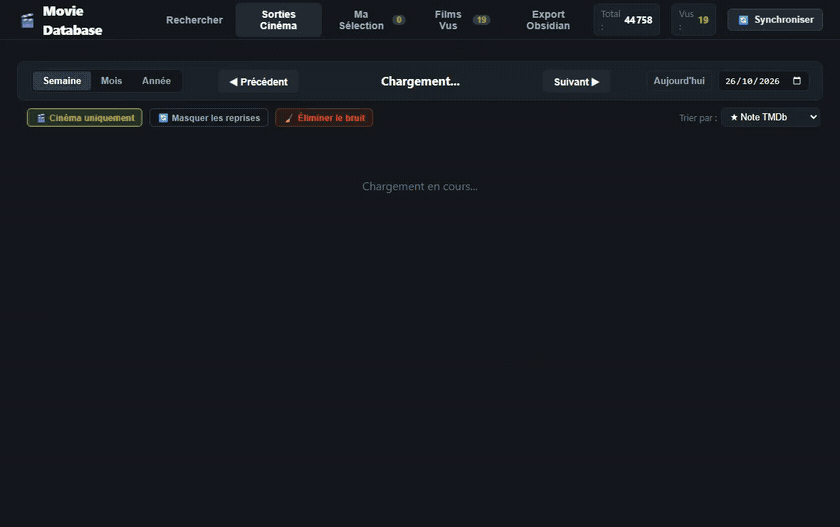
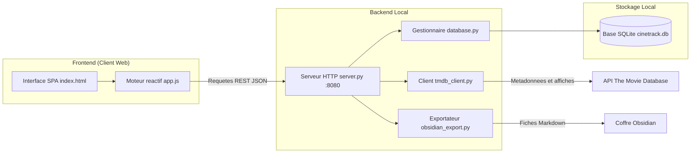

# Movie Database (Letterboxd-Perso)

**Application web locale de tri, notation fine et archivage cinématographique, connectée à TMDb et exportable vers Obsidian.**


---



---

## Architecture

Movie Database fonctionne selon une architecture légère client-serveur en local. Le backend Python (`server.py`) expose une API REST ultra-rapide connectée à une base de données relationnelle locale SQLite (`cinetrack.db`) couvrant l'ensemble des sorties cinéma françaises de 1960 à 2026 (44 758 films répertoriés). Le frontend est une application à page unique (Single Page Application) en Vanilla JavaScript et CSS, garantissant un affichage réactif à zéro latence avec navigation par période optimisée (sélecteurs directs sans étapes intermédiaires) et cache mémoire LRU strictement borné (3 entrées maximum).



> Détails complets des composants et flux : [docs/ARCHITECTURE.md](docs/ARCHITECTURE.md)

---

## Documentation

L'ensemble de la documentation technique et fonctionnelle est centralisé dans le dossier `docs/` :

| Document | Contenu |
|---|---|
| [docs/CADRAGE.md](docs/CADRAGE.md) | Objectifs, périmètre V1, hypothèses et décisions produit (POURQUOI) |
| [docs/ARCHITECTURE.md](docs/ARCHITECTURE.md) | Composants, flux Mermaid, schéma SQLite, sécurité et décisions techniques (COMMENT) |

---

## Démarrage

### Prérequis
- Python 3.10 ou supérieur (recommandé : 3.12)
- Une clé d'API personnelle The Movie Database (gratuite sur themoviedb.org)

### Installation
```bash
git clone git@github.com-perso:floSa/Letterboxd-Perso.git
cd Letterboxd-Perso

# Creation de l'environnement virtuel
python -m venv .venv
.\.venv\Scripts\activate  # Sous Windows (source .venv/bin/activate sous Linux/macOS)

# Installation des dependances minimales
pip install -r requirements.txt
```

### Configuration
Copier le fichier d'exemple et renseigner votre clé TMDb :
```bash
cp config.example.json config.json
```

Éditer `config.json` :
```json
{
  "tmdb_api_key": "VOTRE_CLE_OU_JETON_TMDB"
}
```

### Lancement
- **Sous Windows** : double-cliquer sur `lancer_app.bat` ou lancer la commande suivante :
```bash
python server.py
```
- L'application est immédiatement accessible à l'adresse suivante : `http://localhost:8080`.

---

## Configuration

| Paramètre | Fichier | Valeur par défaut | Rôle |
|---|---|---|---|
| `tmdb_api_key` | `config.json` | `""` | Jeton ou clé API v3/v4 pour interroger TMDb |
| `port` | `server.py` | `8080` | Port d'écoute du serveur HTTP local |
| `db_path` | `database.py` | `cinetrack.db` | Chemin du fichier de base de données relationnelle SQLite |
| `obsidian_vault_path` | `index.html` / UI | `C:\Users\flori\Documents\Obsidian\Films` | Dossier par défaut pour l'export des fiches Markdown |

---

## API et Endpoints

| Méthode | Route | Rôle |
|---|---|---|
| `GET` | `/api/movies?week_date=YYYY-MM-DD` | Liste des sorties d'une semaine (mercredi au mardi) avec tri des reprises |
| `GET` | `/api/movies-month?year=YYYY&month=MM` | Sorties du mois découpées par blocs hebdomadaires |
| `GET` | `/api/movies-year?year=YYYY&page=N` | Grille des films de l'année avec pagination |
| `GET` | `/api/stats` | Compteurs globaux (films répertoriés, vus, conservés, rejetés) |
| `GET` | `/api/watchlist` | Films de la sélection avec filtres (genre, envie min, possession, dates) |
| `GET` | `/api/watched` | Historique des films vus avec filtres et options de tri |
| `GET` | `/api/search` | Recherche d'un film dans la base locale (titre, saga, réalisateur) |
| `GET` | `/api/sync-status` | Progression de la tâche de synchronisation en arrière-plan |
| `POST` | `/api/rate` | Enregistrement d'une note de visionnage ou de priorité d'envie |
| `POST` | `/api/owned` | Bascule de l'état possédé en bibliothèque (0 ou 1) |
| `POST` | `/api/dismiss` | Élimination d'un film des listes de découverte |
| `POST` | `/api/restore` | Restauration d'un film précédemment rejeté |
| `POST` | `/api/clean-noise` | Élimination en masse des films sans affiche, courts ou factices |
| `POST` | `/api/sync` | Lancement de la synchronisation des sorties avec TMDb |
| `POST` | `/api/export-obsidian` | Génération des fiches Markdown et de l'index Dataview |

---

## Structure du projet

```text
Letterboxd-Perso/
├── docs/
│   ├── CADRAGE.md             # Cadrage fonctionnel, perimetre et decisions produit
│   └── ARCHITECTURE.md        # Architecture detaillee, flux et persistance
├── static/
│   ├── index.html             # Structure SPA (Sorties, Selection, Vus, Obsidian)
│   ├── style.css              # Design system sombre, composants et filtres fixes
│   └── app.js                 # Controleur frontend, cache et notation vectorielle
├── server.py                  # Serveur HTTP standard et routeur d'API REST
├── database.py                # Modele SQLite, indexation et regles anti-bruit
├── tmdb_client.py             # Client de decouverte et metadonnees TMDb
├── obsidian_export.py         # Generateur de notes Markdown avec YAML frontmatter
├── cinetrack.db               # Base de donnees locale relationnelle SQLite
├── config.example.json        # Modele de configuration sans secrets
├── config.json                # Configuration locale avec cle API (ignore par Git)
├── requirements.txt           # Dependances Python minimales (requests)
├── lancer_app.bat             # Script de lancement direct sous Windows
└── README.md                  # Vue d'ensemble du projet
```

---

## Licences et composants

| Composant | Rôle | Licence |
|---|---|---|
| Python standard library | Socle applicatif, serveur HTTP, SQLite | Python Software Foundation License |
| requests | Client HTTP pour l'API TMDb | Apache 2.0 |
| SQLite 3 | Moteur de base de données relationnelle locale | Public Domain |
| The Movie Database (TMDb) | Source de données et affiches cinématographiques | TMDb Terms of Use (usage personnel non commercial) |
| Code de Letterboxd-Perso | Code source du projet | MIT |
