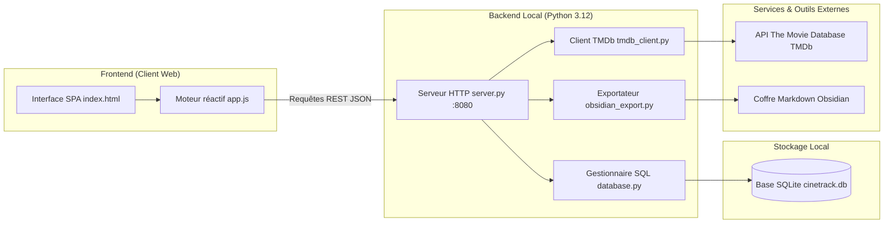
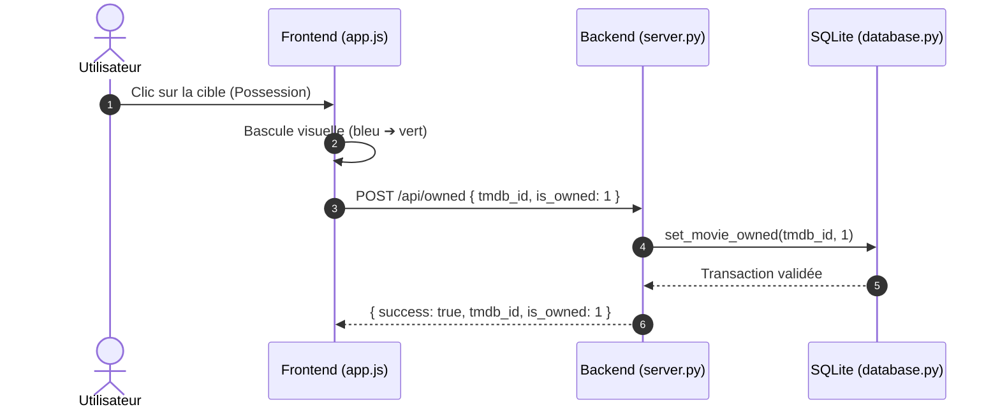

# Architecture — Letterboxd-Perso

## 1. Vue d'ensemble

Letterboxd-Perso repose sur une architecture client-serveur légère en réseau local. Le backend en Python natif assure la passerelle API REST, les calculs de tri/filtrage et la persistance SQLite. Le frontend est une application à page unique (Single Page Application) en Vanilla JavaScript et CSS pur, optimisée pour un rendu fluide et un défilement continu avec barres d'outils fixes.



---

## 2. Composants logiciels

| Composant | Fichier source | Rôle principal |
|---|---|---|
| Serveur HTTP et API | `server.py` | Routeur de requêtes, distribution des fichiers statiques, endpoints REST JSON sur le port `8080` |
| Couche base de données | `database.py` | Schéma relationnel SQLite, requêtes filtrées, pagination, indexation et bascules d'état |
| Synchronisation TMDb | `tmdb_client.py` | Ingestion des sorties hebdomadaires en France, récupération des crédits et métadonnées |
| Exportateur Markdown | `obsidian_export.py` | Transformation des fiches de films en notes Markdown enrichies pour coffres Obsidian |
| Client d'affichage SPA | `static/index.html` | Squelette sémantique des 3 vues majeures (Sorties, Sélection, Vus) et des panneaux de filtres |
| Système de styles | `static/style.css` | Thème sombre, disposition réactive, composants vectoriels et conteneurs fixes (`sticky`) |
| Contrôleur d'interface | `static/app.js` | Gestion d'état local, cache de navigation, requêtes asynchrones et widgets de notation |
| Base de données | `cinetrack.db` | Fichier de base de données relationnelle SQLite contenant l'ensemble des films et des évaluations |
| Configuration | `config.json` | Fichier local contenant la clé d'authentification TMDb et les chemins système |

---

## 3. Stack technologique

| Couche | Technologie | Version / Spécification | Rôle |
|---|---|---|---|
| Langage backend | Python | 3.12 (compatible 3.10+) | Logique applicative et serveur HTTP multi-threadé |
| Moteur de données | SQLite | 3.x | Stockage relationnel local autonome sans serveur dédié |
| Client HTTP distant | requests | 2.32+ | Consommation des endpoints de découverte et de recherche TMDb |
| Langage frontend | JavaScript | ECMAScript 2022+ | Manipulation du DOM, gestion des événements et requêtes Fetch |
| Présentation visuelle | CSS | CSS3 natif | Variables CSS, flexbox, grid, positionnement sticky |

---

## 4. Flux de bout en bout

### Navigation et consultation d'une période
1. L'utilisateur sélectionne une semaine, un mois ou une année sur l'interface.
2. Le script client `app.js` interroge le cache local mémoire (`viewCache`).
3. En cas de manque, une requête HTTP `GET /api/movies?week_date=...` est émise vers `server.py`.
4. Le serveur sollicite `database.py`, qui exécute une requête SQL indexée avec tri des reprises et filtres de rejet.
5. Les données JSON sont retournées en quelques millisecondes et injectées dans le DOM par fragments sans rechargement.

### Notation ou marquage de possession
1. L'utilisateur clique sur une demi-étoile (note), un demi-cœur (priorité) ou la cible (possession).
2. L'interface applique une mise à jour visuelle optimiste immédiate (0 ms).
3. Une requête `POST /api/rate` ou `POST /api/owned` transmet l'identifiant `tmdb_id` et la nouvelle valeur.
4. `database.py` met à jour la ligne dans `cinetrack.db` et valide la transaction (`commit`).
5. Le cache client est invalidé pour synchroniser les listes secondaires (Sélection, Vus).



---

## 5. Stockage et persistance

La base de données locale `cinetrack.db` s'appuie sur la table centrale `movies` :

```text
Table: movies
├── id                     INTEGER PRIMARY KEY AUTOINCREMENT
├── tmdb_id                INTEGER UNIQUE
├── title                  TEXT
├── original_title         TEXT
├── release_date           TEXT (YYYY-MM-DD)
├── year                   INTEGER
├── week_start_date        TEXT (YYYY-MM-DD du mercredi)
├── director               TEXT
├── genres                 TEXT
├── synopsis               TEXT
├── poster_url             TEXT
├── runtime                INTEGER (durée en minutes)
├── vote_average           REAL (note moyenne TMDb)
├── status                 TEXT ('unscreened', 'kept', 'dismissed')
├── is_watched             INTEGER (0 ou 1)
├── want_rating            REAL (note d'envie de 0.0 à 5.0)
├── user_rating            REAL (note de visionnage de 0.0 à 5.0)
├── is_owned               INTEGER (0 ou 1)
├── is_reprise             INTEGER (0 ou 1)
├── original_year          INTEGER
├── original_release_date  TEXT
├── cast                   TEXT
├── created_at             DATETIME
└── updated_at             DATETIME
```

Index d'optimisation :
- `idx_movies_week` sur `week_start_date`
- `idx_movies_year` sur `year`
- `idx_movies_status` sur `status`
- `idx_movies_watched` sur `is_watched`
- `idx_movies_reprise` sur `is_reprise`
- `idx_movies_owned` sur `is_owned`

---

## 6. Décisions d'architecture

- **SQLite intégré plutôt qu'un serveur de base de données relationnelle (PostgreSQL / MySQL)** :
  - *Choix* : SQLite versionné dans le dépôt (`cinetrack.db`).
  - *Justification* : Élimine toute dépendance à un démon système externe, permet le clonage immédiat du projet prêt à l'emploi sur toute machine et garantit des temps de lecture inférieurs à la milliseconde en local.
  - *Limite* : Concurrence d'écriture limitée, convenant uniquement à un profil mono-utilisateur.

- **Composants d'évaluation vectoriels sans dépendance plutôt que bibliothèque de composants** :
  - *Choix* : Construction dynamique de balises SVG pures calibrées à 172 px de largeur dans `app.js`.
  - *Justification* : Permet une division exacte au demi-point, un contrôle rigoureux du décalage visuel et un alignement vertical parfait de l'indicateur de possession sous la première étoile.
  - *Limite* : Nécessite la maintenance manuelle des écouteurs de clics et du calcul de coordonnées de demi-blocs.

- **Double conteneur d'entête fixe (`top-header` à 56 px et `filter-sticky-header`)** :
  - *Choix* : Utilisation des propriétés CSS standard `position: sticky; top: 56px;`.
  - *Justification* : Maintient les filtres accessibles pendant le défilement de catalogues de plusieurs centaines de films sans masquer le contenu ni nécessiter d'événements JavaScript de scroll complexes.
  - *Limite* : Impose de réserver la hauteur de la barre de navigation supérieure dans le calcul des marges.

---

## 7. Sécurité et configuration

| Mesure | Rôle |
|---|---|
| Isolation des secrets | La clé d'API TMDb réside exclusivement dans `config.json`, expressément exclu du suivi Git via `.gitignore`. |
| Modèle de configuration | `config.example.json` sert de gabarit sans divulgation de jetons personnels. |
| Échappement HTML | Toutes les métadonnées textuelles provenant de TMDb ou de la base sont assainies via la fonction `escapeHtml` avant injection dans le DOM. |
| Requêtes préparées | 100 % des interactions SQL dans `database.py` utilisent des requêtes paramétrées avec substitution `?` pour prévenir toute injection SQL. |

---

## 8. Limites connues et recommandations

| Domaine | Limitation actuelle | Piste d'amélioration |
|---|---|---|
| Synchronisation | Déclenchement manuel ou au démarrage pour éviter de dépasser les quotas TMDb | Mise en place d'un cache intelligent des requêtes HTTP avec TTL |
| Multi-machines | Synchronisation assurée par commits Git manuels sur le fichier `cinetrack.db` | Automatisation d'un hook Git de sauvegarde et vérification de conflits |
| Recherche globale | Filtrage textuel exécuté par clauses SQL `LIKE` | Évaluation du module SQLite FTS5 (Full Text Search) en cas d'augmentation massive du catalogue |

---

> Pour les objectifs et choix produit, consulter [CADRAGE.md](CADRAGE.md).
